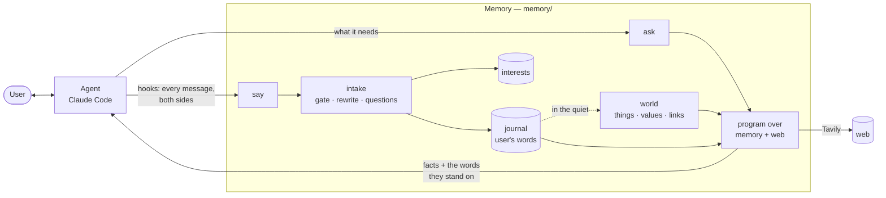

# TerraWeaver — an active personal memory for any agent

Your agent forgets what you said in passing, or remembers it in its own words: "up to 400" with
no idea that it was the budget for the vacuum, "she" with no idea who. You end up dictating
facts to it, and it still decides alone what is worth keeping.

TerraWeaver is a memory that **listens instead of waiting to be told**. It hears the whole
conversation by itself, keeps what you say about your life in your own words — rewritten only so
that it stands alone — reads and structures it in the quiet, and answers the agent with **facts
and the words they stand on, never decisions**. It lives on your machine and keeps no secrets.

Built for the Nebius × NVIDIA Global AI Hackathon, **Personal AI** track. Every model call is an
NVIDIA Nemotron model on **Nebius Token Factory**; web search is **Tavily**.

## Active, not a store

A passive memory is a store: the agent writes into it and reads from it, and everything depends
on the agent remembering to. This one acts by itself:

| It… | How |
|---|---|
| **hears** every message, the user's and the agent's | Claude Code hooks pass both sides; the agent passes nothing |
| **keeps** what is personal, in the user's words | the decision model gates; Nemotron Super resolves "it", "those", "up to 400" from the agent's message, then the agent's message is dropped |
| **reads in the quiet** | after 30 s of silence the world reads the journal into things, values and links |
| **notes interests** | every question of the user's is kept with how often it comes back: what to get ready for next time |
| **gathers** when the agent asks | a program written by Nemotron over the memory and the web (Tavily), checked condition by condition |
| **protects** | secrets are withheld before any model sees them; a web query that names a person from the memory is refused |

## What it looks like

Over a few sessions, in passing:

> My wife Mila and I live in Belgrade. · Mila said she'd love to go to one of those candlelight
> concerts. · I like evenings out on Friday or Saturday; Sunday evenings I prepare for work. ·
> Neither of us likes loud clubs.

A week later, in a new session:

> **User:** My wife mentioned some concert she'd love to go to, and I have no idea what it is. Can
> you find out what it is and when we could go, on a weekend in the next three months?

The memory had kept *"My wife mentioned the concert she'd love to go to… when my wife and I could
go"* — and from before: candlelight, Belgrade, Friday or Saturday, no loud clubs. The agent asks
it; it searches the web and answers with every candidate against every condition (`weekend: met`,
`within three months: NOT met — "Jan 30, 2027"`). The agent tells the user the truth: candlelight
concerts in Belgrade, none on a weekend inside the window, the nearest one two days after it.

> **User:** Which of those is on a Saturday?

The memory keeps it as *"Which of the listed concerts is on a Saturday?"* — the agent answers from
what it just said.

## How it works



**Two doors.** `say(messages)` — what was said, with who said it; with the Claude Code plugin the
hooks call it and the agent never does (`X-Personal-Hooks: on` tells the server so, and it refuses
a second copy). `ask(question)` — the agent's own question: answered from what the memory holds,
or gathered when something has to be found.

**The intake** (`memory/intake/`) reads one user message with the agent's message just before
it — never more: what came earlier the memory already holds. The decision model, shown the last
four messages, says whether there is anything personal; Nemotron Super, thinking, rewrites the
message to stand alone and copies its questions out. The prompts are plain files in
`memory/intake/prompts/`.

**Facts, not decisions.** A gathering returns candidates with each of the user's conditions
judged against the words of the page. Choosing is the agent's, with the user.

## NVIDIA Nemotron on Nebius Token Factory

Every model is bound to a role in `memory/models.py`; any role can be moved to another model by
an environment variable (`TERRAWEAVER_<ROLE>=…`).

| Role | Model | What it does |
|---|---|---|
| resolver | Nemotron 3 Super 120B-A12B, thinking | rewrites a user message to stand alone; new topic; its questions |
| sorter | Nemotron 3 Super | the gate: personal or not; the kind of a question; same question as before? |
| reader | Nemotron 3 Super | reads the journal and web pages into things, values and links |
| judge | Nemotron 3 Nano 30B-A3B | closed questions as probabilities from **logprobs**: "does this quote say that?" — one token, calibrated |
| programmer | Nemotron 3 Ultra 550B-A55B | writes the program that solves a task, and sorts the user's limits from wishes |
| embeddings | Token Factory embeddings | search by meaning |

One client (`terraweaver/nemotron.py`) serves a model both as an LLM and as a **decision model**:
yes/no and choice questions are answered from the first token's logprobs, so a gate costs one
token and comes with a probability instead of a guess. Token Factory made it possible to put the
biggest model where one call decides a lot (the programmer) and the small one where hundreds of
calls each decide a little (the judge).

**Tavily** is the web: `memory/tools.py` searches and takes the pages' text through it (directly,
or through the author's `ait-search` when it is installed).

## Run it

Needs Python 3.12+, [Claude Code](https://claude.com/claude-code), and keys for Nebius Token
Factory and Tavily.

```bash
git clone https://github.com/mihail-gribov/terraweaver && cd terraweaver
python3 -m venv .venv && .venv/bin/pip install -r requirements.txt
cat > .env <<'EOF'
NEBIUS_API_KEY=...
TAVILY_API_KEY=...
EOF
set -a; . ./.env; set +a

# 1. the memory: var/memory/main/, MCP at http://127.0.0.1:7110/mcp
.venv/bin/python -m memory.server

# 2. in another terminal: Claude Code with the plugin, in the personal world from the first message
adapters/claude_code/claude-personal
```

Talk about your life in passing, then ask for something that depends on it. What the memory keeps
is plain Markdown: `var/memory/main/facts.md`. What it heard and answered: `heard.jsonl` beside it.
Inside any Claude Code session with the plugin, `/personal` turns the mode on and `/personal off`
leaves it.

**The scripted dialogues** — a real Claude Code host, the history told over sessions, then the
task, judged on the answers:

```bash
.venv/bin/python experiments/13_dialogues/run.py concert     # also: vacuum, colleagues, all
```

**Tests:** `.venv/bin/python tests/run_all.py` (no model calls in the memory's tests; some of the
world's call models).

## Repository

```
memory/                the product: the active memory
  server.py            say / ask over MCP, /say for hooks
  listen.py            what the memory does with what it hears
  intake/              one message read with the agent's before it; prompts/ as files
  journal.py           the journal of facts, in the user's words
  world.py             reading the journal in the quiet
  solve.py, programs.py, tools.py, parse.py, search.py   gathering and answering
  models.py            which Nemotron plays which role
adapters/claude_code/  the plugin: hooks, the skill, claude-personal
terraweaver/           the world engine: object model, ontology, formalisation, Nemotron client
experiments/           numbered experiments, each with what it measured
tests/                 one script per subject, run_all.py runs them
docs/decisions.md      every behaviour change with its reason
```

## Measured

- **Dialogues** (`experiments/13_dialogues`, Claude Haiku as the host): concert, vacuum (limits
  told in passing over two sessions, a pick from the web) and colleagues (links that change
  across sessions) pass.
- **The rewrite**, 16 hand checks on the dialogues: 13–16 of 16 over six runs; "we/us" left as the
  user said it when the agent's message does not say who: 32 of 32.
- Every number, and every change made because of one, is in `docs/decisions.md`.

## What's next

- **Preparing ahead by interest.** The user's questions are kept and counted; next, the world
  reads first what the user keeps coming back to, so the answer is ready before it is asked again.
- **Forgetting on the user's word.** The memory can take entries out once the user confirms which;
  next, reading "forget everything about Olga" reliably, and the words gone everywhere they reached.
- **Topics, each with its summary.** The journal cut into topics and joined across sessions, each
  topic summarised and kept apart, rebuilt from the user's words: "we talked about this last
  year" raises what that talk came to.
- **Hooks beyond Claude Code.** Any agent with MCP can use `say` and `ask` today, passing the
  messages itself; next, the same hooks for other agents, so none of them has to remember to.

One run measures little here: the spread between runs is as large as the differences, so every
number above comes with its repeats in `docs/decisions.md`.

## License

MIT — see [LICENSE](LICENSE).
