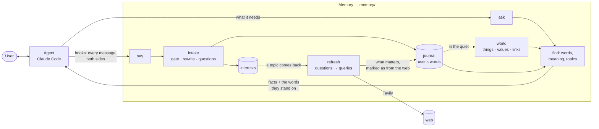

# TerraWeaver — your memory, for every AI agent

**One personal memory you own. It grows with every conversation and follows you from one agent to the next.**

**Site and demo: https://terraweaver.life** · **Video: https://www.youtube.com/watch?v=3hGvaQWsNGA**

Your agent forgets what you said in passing, or remembers it in its own words: "up to 400" with
no idea that it was the budget for the vacuum, "she" with no idea who. You end up dictating
facts to it, and it still decides alone what is worth keeping.

TerraWeaver is a memory that **listens instead of waiting to be told**. It hears the whole
conversation by itself, keeps what you say about your life in your own words — rewritten only so
that it stands alone — reads and structures it in the quiet, and answers the agent with **facts
and the words they stand on, never decisions**. It lives on your machine and keeps no secrets.

Built for the Nebius × NVIDIA Global AI Hackathon, **Personal AI** track. Every language-model call
is an NVIDIA Nemotron model on **Nebius Token Factory**; search by meaning uses a small local
embedding model by default, or an NVIDIA Nemotron embedding model through OpenRouter when set (the
demo does); web search is **Tavily**.

## Your memory. Every AI agent.

One personal memory you own. It grows with every conversation and follows you from one agent to
the next.

1. **Yours, for any agent.** It speaks MCP through two doors, `say` and `ask`, so any agent can use
   it, and what it keeps is plain files on your machine: a Markdown journal you can read.
2. **It remembers on its own.** Hooks pass every message of the conversation; the agent is never
   asked to remember to save, and cannot forget to.
3. **Trust: your own words.** What is kept is what you said, rewritten only so that it stands alone;
   every fact is shown with the entry it comes from, checked by code. Secrets are withheld before
   any model sees them, private matters are not put into web queries, and names are kept out of
   them by code.
4. **Quality.** Time, change and links are kept (what happened when, how many, how it stands now,
   where we left off), topics are kept current from the web, and reading costs the same for each
   entry however long the history is.

## Active, not a store

A passive memory is a store: the agent writes into it and reads from it, and everything depends
on the agent remembering to. This one acts by itself:

| It… | How |
|---|---|
| **hears** every message, the user's and the agent's | Claude Code hooks pass both sides; the agent passes nothing |
| **keeps** what is personal, in the user's words | the decision model gates; Nemotron Super resolves "it", "those", "up to 400" from the agent's message, then the agent's message is dropped |
| **reads in the quiet** | as soon as an entry is kept, beside the conversation, the memory reads it into things, values and links |
| **notes interests** | every question of the user's is kept with how often it comes back: what to get ready for next time |
| **keeps topics fresh** | a topic without a web update for a month is looked up in the background (Tavily), at most once an hour; what matters is kept in the journal, marked as from the web |
| **protects** | secrets are withheld before any model sees them; web queries are made from the topic, the model is told to leave out private details, and code drops any query that holds the name of a person in the memory |

## What it looks like

Over a month, in passing, inside talks about a calendar, a weekend and a dinner:

> The eleventh is my wife Mila's birthday. · Mila hates crowds, a small jazz gig would suit her. ·
> Yes, please (to the agent's "skip the Thai place?") · A quiet evening, just the two of us. ·
> Her mother Vesna may still be staying with us.

Today, in a new session, the user only says: *help me plan her birthday evening.* Nobody asks the
memory anything. The hook passes the message, the memory puts beside it the facts it holds on that
matter, and the agent answers: the date, quiet and just the two of them, jazz, no peanuts (Mila is
seriously allergic), and Vesna who may be staying.

The same for a number: sums said in passing over weeks (a TV, a soundbar, a washing machine, a
plumber; a car service that is not the home), then *how much have we spent on the home since
October?* The memory gathers the facts with their days, and the agent adds them up.

## How it works



**Two doors.** `say(messages)` — what was said, with who said it; with the Claude Code plugin the
hooks call it and the agent never does (`X-Personal-Hooks: on` tells the server so, and it refuses
a second copy). `ask(question)` — the agent's own question: answered with the facts the memory holds on it
and the words they stand on.

**The intake** (`memory/intake/`) reads one user message with the agent's message just before
it — never more: what came earlier the memory already holds. The decision model, shown the last
four messages, says whether there is anything personal; Nemotron Super, thinking, rewrites the
message to stand alone and copies its questions out. The prompts are plain files in
`memory/intake/prompts/`.

**Facts, not decisions.** The memory finds the entries a question needs (words and meaning
fused, then the people and topics the graph knows) and hands over their texts. It never
chooses for the agent or the user.

**The web, for topics that change.** The object of a web refresh is the topic. A topic whose latest
web entry is older than a month is due, unless the user has not come back to it for three months
(then it is no longer relevant). A scheduler inside the server sweeps the due topics in the
background, at most once an hour; a small Nemotron first asks whether what is outside would change
for the topic (places, events, prices — not the user's own plans or people), the queries carry no
person's name or private detail, Tavily finds pages, and what matters goes into the same journal
as an entry marked as from the web. The agent hears of it with the memory's next answer.

## NVIDIA Nemotron on Nebius Token Factory

Every model is bound to a role in `memory/models.py`; any role can be moved to another model by
an environment variable (`TERRAWEAVER_<ROLE>=…`).

| Role | Model | What it does |
|---|---|---|
| resolver | Nemotron 3 Super 120B-A12B, thinking | rewrites a user message to stand alone; new topic; its questions |
| sorter | Nemotron 3 Super | the gate: personal or not; the kind of a question; same question as before? |
| reader | Nemotron 3 Super | reads the journal and web pages into things, values, links and topics |
| judge | Nemotron 3 Nano 30B-A3B | closed questions as probabilities from **logprobs**: "does this quote say that?", "does this matter?" — one token, calibrated |
| embeddings | NVIDIA Nemotron embed (`nvidia/nemotron-3.5-embed-1b`) via OpenRouter | search by meaning; `fastembed` locally by default |

One client (`memory/nemotron.py`) serves a model both as an LLM and as a **decision model**:
yes/no and choice questions are answered from the first token's logprobs, so a gate costs one
token and comes with a probability instead of a guess. Token Factory made it possible to put the
middle model where text is read and rewritten (a few calls per message) and the small one where
hundreds of calls each decide a little (the judge), by changing one name.

**Tavily** is the web: `memory/web.py` searches and takes the pages' text through it.

## Try it

**The demo instance** (for evaluation only): https://terraweaver.life. It is one shared memory:
**do not tell it anything personal**, talk about an invented life. For real use, run the memory on
your own machine, below.

You need [Claude Code](https://claude.com/claude-code) or another MCP client, and a key:

- sign in with Google at https://terraweaver.life/account/ (API keys → Make key; `tw_...`, shown once, up to five, each can be revoked), or
- a reviewer token, given with the submission, if you have no Google account.

```bash
export PERSONAL_MEMORY_URL=https://terraweaver.life
export PERSONAL_MEMORY_TOKEN=<the tw_ key or the reviewer token>
adapters/claude_code/claude-personal        # Claude Code with the plugin, from a clone of this repository
```

Other MCP clients: URL `https://terraweaver.life/mcp`, header `Authorization: Bearer <key>`. Then talk
about an invented life in passing, and ask for something that depends on it; the first `ask` may
wait while the memory reads. The key is for the hosted memory only; your own `NEBIUS_API_KEY` and
`TAVILY_API_KEY` are needed only when you run it locally.

## Run it

Needs Python 3.12+, [Claude Code](https://claude.com/claude-code), and keys for Nebius Token
Factory and Tavily.

```bash
git clone https://github.com/mihail-gribov/terraweaver && cd terraweaver
python3 -m venv .venv && .venv/bin/pip install -r requirements.txt
cat > .env <<'EOF'
NEBIUS_API_KEY=...
TAVILY_API_KEY=...
EOF
set -a; . ./.env; set +a

# 1. the memory: var/memory/main/, MCP at http://127.0.0.1:7110/mcp
.venv/bin/python -m memory.server

# 2. in another terminal: Claude Code with the plugin, in the personal world from the first message
adapters/claude_code/claude-personal
```

What leaves your machine: the messages and entries go to the Nemotron models on Nebius Token Factory;
web queries go to Tavily; entry texts go to OpenRouter only if you turn the embeddings on there. The
first search downloads the small local embedding model (about 130 MB) from Hugging Face.

Search by meaning runs locally (`fastembed`) unless you set `TERRAWEAVER_EMBEDDINGS=openrouter` and
`OPENROUTER_API_KEY` (the NVIDIA Nemotron embedding model, no local model needed).

Talk about your life in passing, then ask for something that depends on it. What the memory keeps
is plain Markdown: `var/memory/main/facts.md`. What it heard and answered: `heard.jsonl` beside it.
Inside any Claude Code session with the plugin, `/personal` turns the mode on and `/personal off`
leaves it.

**A month of ordinary use, told to a real Claude Code host** (the birthday story of the demo video):

```bash
.venv/bin/python scripts/demo_recall.py --story birthday     # also: tv, home, jazz
```

**The scenarios benchmark** (short histories, one class of task each, scored by words):

```bash
.venv/bin/python benchmarks/scenarios.py [--only family,books]
```

**Tests:** `.venv/bin/python tests/run_all.py`.

## Repository

```
memory/                the product: the active memory
  server.py            say / ask over MCP, /say for hooks
  listen.py            what the memory does with what it hears
  intake/              one message read with the agent's before it; prompts/ as files
  journal.py           the journal of facts, in the user's words
  graph.py             the skeleton: entities, links, topics in layers, the user's world
  search.py            words and meaning, fused
  refresh.py, web.py   a topic the user comes back to, checked on the web (Tavily)
  models.py            which Nemotron plays which role
adapters/claude_code/  the plugin: hooks, the skill, claude-personal
benchmarks/            scenarios.py: the scenarios benchmark, and the runs kept as evidence
scripts/               demo_recall.py and the replay player behind the demo video
experiments/           numbered experiments, each with what it measured
tests/                 one script per subject, run_all.py runs them
docs/decisions.md      every behaviour change with its reason
```

## Measured

**Scenarios** (`benchmarks/scenarios.py`): five short personal histories (family, books, running,
home, trips), a dozen talks over two months among thirty of everyday talk, each told through `say`
on a fresh memory, then checked by words. The first run of the day gave 39 of 45, and after the fixes the misses pointed at, **43 of 45**. The histories were seen during development, so the second number is tuned on them.

| Class of task | Passed |
|---|---|
| latest value (what holds now) | 11 / 11 |
| time (days, order, how long ago) | 8 / 8 |
| count (events spread over talks) | 7 / 7 |
| who is who | 4 / 4 |
| recall (nobody asks) | 7 / 8 |
| never said, so "I don't know" | 6 / 7 |

The two misses are real: a car alarm question that did not bring up the user's Skoda Octavia, and
a sale of a Golf that was never told, which the memory answered instead of declining. The run, its
journals, traces and tokens are kept under `benchmarks/runs/`.

Every number, and every change made because of one, is in `docs/decisions.md`. One run measures
little here: the spread between runs is as large as the differences.

## What's next

- **Wider measurement.** Public memory benchmarks with baselines, ablations and confidence
  intervals; today only the scenarios benchmark above is measured.
- **One memory across two agents.** A demo of the same memory serving two different agents, with
  automatic recall in both.
- **Memory control.** View, edit, forget everywhere (the derived heard and trace logs included) and
  export; forgetting an entry already drops it from the journal, the vectors and the graph.
- **Cost.** The price per 1,000 messages, and how it grows at 10k, 100k and 1M.
- **Usefulness.** How much more useful an agent is with TerraWeaver than without it, in everyday
  work.
- **Hooks beyond Claude Code.** Any agent with MCP can use `say` and `ask` today, passing the
  messages itself; next, the same hooks for other agents.

## License

MIT — see [LICENSE](LICENSE).
